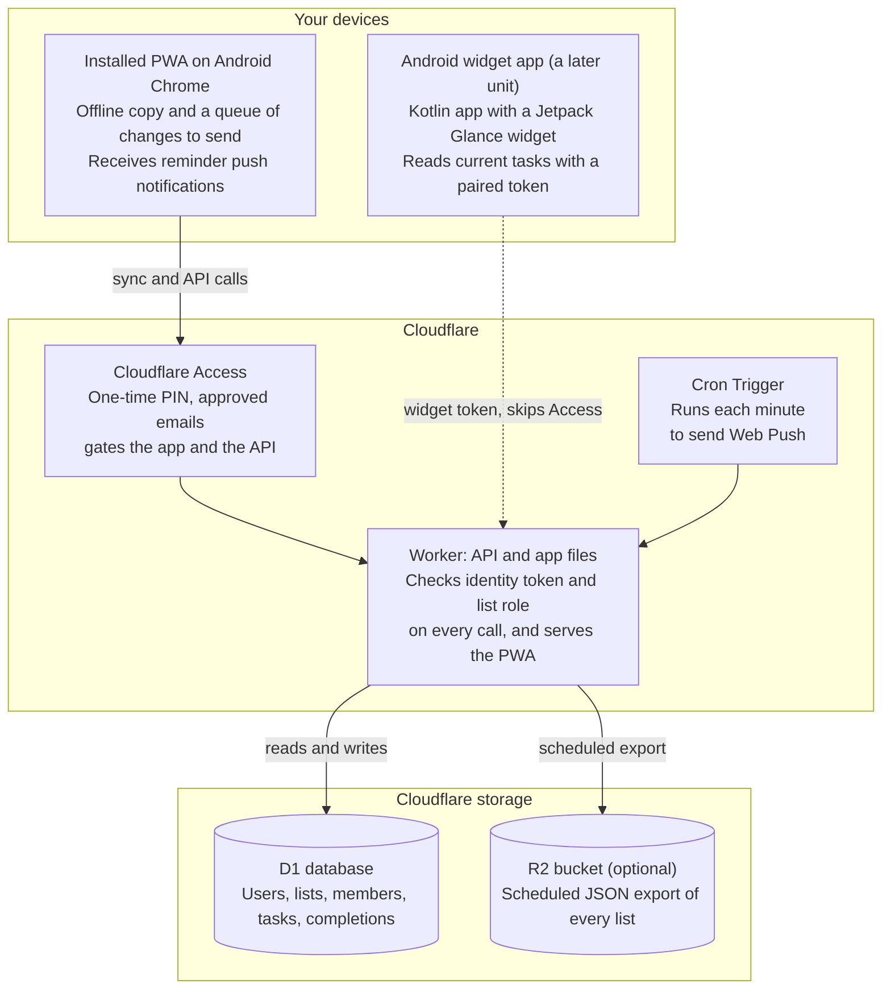

# Family To-Do PWA: AIDLC Specification

As of Oct 30, 2026.

## Intent and scope

**Intent:** a private, installable to-do app for fewer than 10 people that handles one-off and repeating tasks, supports shared lists, works well on Android (ideally with a home screen widget), and runs entirely on Cloudflare.

**Goals**

- Cover every task type you listed: undated, dated (with optional time), repeating on a fixed schedule (days of week, month, year), and repeating a set interval after the last completion.
- One account per person, any number of lists, and lists that can be shared with specific people.
- Installable PWA, fast and usable offline on Android, with reminders.
- Free or near-free to run, and low effort to maintain.

**Non-goals (v1)**

- Public sign-up, teams or organizations, billing, or an app-store listing.
- Subtasks, attachments, comments, and natural-language task entry.
- iOS widgets. The app should still install and work on iOS as a PWA.

**Assumptions to confirm** (also listed under open questions)

- Everyone using it is someone you personally invite, so a closed allowlist is acceptable.
- You are comfortable owning a TypeScript codebase and deploying it with Wrangler.
- Each person has one home time zone, which the app uses for "today" and reminders.

**How this spec is organized.** It follows the AI-DLC phases: Inception (requirements, stories, workflow plan, application design, units of work), Construction (per-unit design, then code, build and test), and Operations. Requirement IDs (FR, NFR) trace to stories (US) and to units (U1 to U8).

## Inception 1: Requirements

The app needs 26 functional requirements and 10 non-functional ones; 19 of the functional ones are Must-haves for v1. The one requirement a plain PWA cannot meet is FR-25, the Android widget, which is why it is rated Should and handled in its own unit.

### Functional requirements

| ID | Requirement | Priority |
| --- | --- | --- |
| FR-1 | Create a task with a title and optional notes, belonging to exactly one list. | Must |
| FR-2 | One-off task with no date. | Must |
| FR-3 | One-off task with a due date and an optional due time. | Must |
| FR-4 | Edit, complete, un-complete and delete a task. | Must |
| FR-5 | Repeat on chosen days of the week, every N weeks (default 1). | Must |
| FR-6 | Repeat monthly on a day of the month. Short months use the last day. | Must |
| FR-7 | Repeat monthly on the Nth weekday (for example the 2nd Tuesday) or on the last day of the month. | Should |
| FR-8 | Repeat yearly on a month and day. A Feb 29 task falls on Feb 28 in non-leap years. | Must |
| FR-9 | Repeat X days, weeks or months after the last completion date. | Must |
| FR-10 | Completing a recurring task records the completion and moves the task to its next due date. Missed occurrences are skipped, never stacked. | Must |
| FR-11 | Skip this occurrence, and snooze to a later time or date. | Should |
| FR-12 | Optional end for a recurrence: an end date or a number of occurrences. | Could |
| FR-13 | Per-task completion history for recurring tasks. | Should |
| FR-14 | Reminder at the due time, or an offset before it. Date-only tasks use the person's default reminder time. | Must |
| FR-15 | Web Push delivery of reminders to the installed Android PWA. | Must |
| FR-16 | Views: Today, Upcoming, Overdue, No date, and each list. | Must |
| FR-17 | Each person has their own account with a time zone and default reminder time. | Must |
| FR-18 | Access is closed: only emails you approve can sign in. | Must |
| FR-19 | Create, rename, archive and delete lists. | Must |
| FR-20 | Share a list with another account by email as owner, editor or viewer. | Must |
| FR-21 | Owner can remove members or transfer ownership; a member can leave. | Should |
| FR-22 | A shared task has one state: completing it completes it for everyone. | Must |
| FR-23 | Optional assignee on a task in a shared list. | Could |
| FR-24 | Installable PWA with an offline-capable app shell. | Must |
| FR-25 | Android home screen widget showing today's and overdue tasks, with tap to complete. | Should |
| FR-26 | Offline create, edit and complete, synced when the connection returns. | Must |

### Non-functional requirements

| ID | Requirement | Target |
| --- | --- | --- |
| NFR-1 | Scale | 10 users or fewer, about 5,000 active tasks in total. |
| NFR-2 | Cost | $0 on free tiers, with a $5 per month fallback if a limit is hit. |
| NFR-3 | Security | Everything sits behind Cloudflare Access; the API verifies the identity token on every call and checks list membership server-side. |
| NFR-4 | Privacy | Data lives only in your Cloudflare account; no third-party analytics or trackers. |
| NFR-5 | Responsiveness | Interactions complete from the local store with no spinner; sync within 5 seconds of regaining connectivity or focus. |
| NFR-6 | Recoverability | Point-in-time restore plus a scheduled JSON export you control. |
| NFR-7 | Correctness | The recurrence engine passes a table-driven test suite covering month ends, leap days, daylight saving changes and time zones. |
| NFR-8 | Usability | Touch targets of at least 48 dp, dark mode, respects system font size. |
| NFR-9 | Maintainability | One TypeScript repository, infrastructure in code, versioned database migrations. |
| NFR-10 | Compatibility | Current and previous Chrome on Android; iOS Safari as best effort. |

## Inception 2: User stories

There are 18 stories for two personas: the **Owner**, who sets up access and invites people, and a **Member**, who mostly uses an Android phone. The recurrence stories (US-4 to US-8) carry the most risk and are written as testable examples.

| ID | Story | Acceptance criteria | Covers |
| --- | --- | --- | --- |
| US-1 | As a user I add a task with just a title. | It appears in my chosen list at once, even offline, with no date required. | FR-1, FR-2 |
| US-2 | As a user I give a task a due date, and optionally a time. | A date-only task shows under Today on that day and turns overdue after that day ends in my time zone. | FR-3, FR-16 |
| US-3 | As a user I complete or un-complete a task. | Tapping the checkbox completes it with a 5 second undo; completed tasks leave active views and stay visible under Completed. | FR-4 |
| US-4 | As a user I repeat a task on certain weekdays. | A Mon and Thu task completed on Monday becomes due Thursday; completed on Thursday it becomes due the next Monday. | FR-5, FR-10 |
| US-5 | As a user I repeat a task monthly. | A day-31 task is due Feb 28 (Feb 29 in leap years) and Apr 30. A 2nd-Tuesday task shows the correct next 2nd Tuesday. | FR-6, FR-7 |
| US-6 | As a user I repeat a task yearly. | A Feb 29 task is due Feb 28 in non-leap years and Feb 29 in leap years. | FR-8 |
| US-7 | As a user I repeat a task a set time after I last did it. | "Every 10 days after completion" completed on Mar 3 is due Mar 13, whether done early or late. "Every 1 month" completed Jan 31 is due Feb 28. | FR-9 |
| US-8 | As a user I am not buried by missed repeats. | A weekly task 3 weeks overdue, once completed, shows only the next future occurrence and logs one completion. | FR-10, FR-13 |
| US-9 | As a user I skip or snooze a repeat. | Skip advances to the next occurrence without logging a completion; snooze moves only this occurrence. | FR-11 |
| US-10 | As a user I get a reminder. | A push arrives at the due time (or at my default time for date-only tasks); tapping it opens the task. | FR-14, FR-15 |
| US-11 | As a member I sign in with my email. | Opening the app prompts for my email and a one-time code. An unapproved email receives no code. First sign-in creates my account. | FR-17, FR-18 |
| US-12 | As an owner I share a list with someone by email. | The person sees the list after their next sync, even if they have not signed in before. Editor and viewer limits are enforced by the API, not just the UI. | FR-19, FR-20 |
| US-13 | As a member of a shared list I complete a shared task. | Other members see it completed after sync; a recurring task shows the same next due date to everyone. | FR-22 |
| US-14 | As an owner or member I manage membership. | Owner can remove a member or transfer ownership; a member can leave; a removed member loses access on their next sync. | FR-21 |
| US-15 | As a user I work offline. | In airplane mode I can add, edit and complete tasks. On reconnect they sync; if two people changed the same field, the later edit wins and no task is lost. | FR-26 |
| US-16 | As a user I install the app on Android. | Chrome offers install; the app opens full screen and its shell loads with no network. | FR-24 |
| US-17 | As an Android user I see today's tasks on my home screen. | The widget lists today's and overdue tasks, refreshes about every 30 minutes and after I complete a task in the app, and lets me tick one off. | FR-25 |
| US-18 | As an owner I can export all my data. | One action downloads my lists, tasks and completion history as JSON. | NFR-6 |

## Inception 3: Workflow plan

This is a small greenfield app, so every Inception stage runs once at standard depth, Construction runs per unit, and only the recurrence engine and the sync layer get deep design work. You are the single approver at each gate, which stands in for AIDLC's team "Mob Elaboration" and "Mob Construction" sessions. Stage names below follow the AIDLC flow as commonly described; the open-source workflow repository has since grown more stages, so map names if you use it.

| Stage | Plan | Reason |
| --- | --- | --- |
| Reverse engineering | Skip | Greenfield, no existing code. |
| Requirements analysis | Done | Section above. |
| User stories | Done | Section above. |
| Workflow planning | Done | This section. |
| Application design | Done | Next section. |
| Units generation | Done | Section after it. |
| Functional design, per unit | Deep for U2 (recurrence) and U3 (sync); light for the rest | Those two carry the correctness risk. |
| NFR requirements and design | Once, whole app | Small scale; one pass is enough. |
| Infrastructure design | Once | One Cloudflare account, one environment plus a preview. |
| Code generation, per unit | One bolt per unit | Each unit ships behind tests before the next starts. |
| Build and test | Per unit, then end to end | Includes an Android device pass. |
| Operations | Light | Deployment, backup and monitoring for a handful of users. |

**Approval gates (your decisions)**

1. After application design: confirm the sign-in approach and the Android widget approach, since both change the architecture.
2. After U2: the recurrence test suite is green and you have read its examples.
3. Before first production deploy: security checklist signed off.
4. After the first week of real use: triage what to change before adding anything new.

## Inception 4: Application design

The design is a local-first PWA that talks to one Cloudflare Worker backed by D1 and gated by Cloudflare Access. The Android widget needs a thin native companion app, because the PWA widget support I found is documented only for the [Windows 11 Widgets Board](https://learn.microsoft.com/en-gb/microsoft-edge/progressive-web-apps/how-to/widgets), not for Android home screens.



A sync request from the PWA passes Access and reaches the Worker, the only component that touches D1. The widget uses its own token on two narrow paths. Reminders are sent by a cron job inside the same Worker.

### Stack

| Layer | Choice | Why |
| --- | --- | --- |
| Client | Vite, React, TypeScript, service worker via Workbox | Widely supported, easy to build and test in small units. |
| Local store | IndexedDB through Dexie | Makes the app usable offline and instant. |
| API | Cloudflare Worker using Hono | One deployable, same language as the client. |
| Database | Cloudflare D1 (SQLite) | Relational fit for lists, members and tasks. |
| Static hosting | The same Worker serves the built app | One origin, so no cross-origin headaches with Access. |
| Sign-in | Cloudflare Access, one-time PIN, approved-emails policy | No password code to write or secure. |
| Reminders | Worker Cron Trigger each minute plus Web Push (VAPID) | Android Chrome delivers push to an installed PWA. |
| Backups | Scheduled JSON export to R2 | Independent copy you control. |
| Android widget | Small Kotlin app with a Jetpack Glance widget, sideloaded | Only route to a real home screen widget. |

### Decisions for you

| # | Decision | Recommendation | Main alternative |
| --- | --- | --- | --- |
| D1 | Sign-in | Cloudflare Access with one-time PIN. It is [free for up to 50 users](https://www.cloudflare.com/en-au/products/cloudflare-access), and the PIN email is [sent only when your policy allows that address](https://developers.cloudflare.com/cloudflare-one/integrations/identity-providers/one-time-pin/). Cost: you add each new person to the policy. | Build passkey or password auth into the Worker: more control, much more to get right. |
| D2 | Android widget | Ship the PWA first, then add the native companion as its own unit. Until then, a daily summary push gives much of the value. | PWA only, no widget (drops FR-25), or a native-only app (loses the single codebase). |
| D3 | Sync | Local-first with an outbox of operations, server revision numbers, and per-field last-write-wins. | Online-only is simpler but breaks FR-26; CRDTs are overkill for 10 people. |
| D4 | Recurrence engine | Own small TypeScript module shared by client and Worker. "After completion" is not part of the standard RRULE format, and the fixed rules needed here are a small subset. | An RRULE library for fixed rules plus custom code for the rest. |
| D5 | Database | D1 with an index on next reminder time. | One Durable Object per list: real-time fan-out, but more moving parts. |

**Capacity check (my estimates).** Ten people making 500 API calls a day is about 5,000 requests, against a Workers Free allowance of [100,000 requests a day](https://eastondev.com/blog/en/posts/dev/20260526-cloudflare-free-limits/). D1 on the free plan allows [5 million row reads and 100,000 row writes a day](https://freetier.co/cloudflare-free-tier), and since September 1, 2026 [queries fail once either limit is exceeded](https://developers.cloudflare.com/changelog/post/2026-09-01-d1-free-tier-limit-enforcement/). Normal use is far below both, but the every-minute reminder query must read only a few indexed rows, never scan the table.

### Data model

| Table | Key fields |
| --- | --- |
| user | id, email (unique), display name, time zone, default reminder time |
| list | id, name, owner, archived flag, revision, deleted flag |
| list_member | list, user or invited email, role (owner, editor, viewer) |
| task | id, list, title, notes, due date, due time, task time zone, repeat rule (JSON), anchor date, status, next reminder time (UTC), last reminded occurrence, assignee, revision, deleted flag |
| completion | id, task, occurrence due date, completed by, completed at |
| device | id, user, kind (web push or widget), push endpoint or token hash, last seen |
| counter | one row holding the global revision number used by sync |

Ids are generated on the client (time-sortable UUIDs) so offline creation never collides. Deletes are flagged, not removed, so other devices learn about them.

### Recurrence rules

A task's repeat rule is stored as JSON. Weekly, monthly and yearly rules count from an anchor date, which is what makes "every 2 weeks" unambiguous.

```json
{ "kind": "weekly", "every": 1, "days": ["MO", "TH"] }
{ "kind": "monthly_day", "every": 1, "day": 31 }
{ "kind": "monthly_nth", "every": 1, "nth": 2, "weekday": "TU" }
{ "kind": "yearly", "month": 2, "day": 29 }
{ "kind": "after_completion", "every": 10, "unit": "day" }
```

1. **Fixed rules:** the next due date is the first occurrence strictly after the later of the current due date and the completion date. That single rule completes early, on time or late without ever stacking missed occurrences.
2. **After-completion rules:** the next due date is the completion date plus the interval, with month arithmetic clamped to the last day of the month. The time of day is kept.
3. **Skip:** advances like a completion but writes no completion record.
4. **Idempotent completion:** the completion action carries the occurrence it completes. If the task has already moved past that occurrence (two people tapped at once, or an offline replay), the server ignores the duplicate.
5. **Time zones:** occurrences are computed in the task's time zone. A time that does not exist on a daylight saving change moves to the next valid time that day.
6. **Nth weekday:** offered for 1st to 4th and last, so there is never a missing 5th.

These examples become the first test cases for U2:

| Rule | Due | Completed | Next due |
| --- | --- | --- | --- |
| Weekly on Mon and Thu | Mon Oct 5, 2026 | Mon Oct 5, 2026 | Thu Oct 8, 2026 |
| Weekly on Mon | Mon Oct 5, 2026 | Mon Oct 26, 2026 (3 weeks late) | Mon Nov 2, 2026 |
| Every 2 weeks on Fri, anchored Oct 2 | Fri Oct 16, 2026 | Fri Oct 16, 2026 | Fri Oct 30, 2026 |
| Monthly on day 31 | Sun Jan 31, 2027 | Sun Jan 31, 2027 | Sun Feb 28, 2027 |
| Monthly on 2nd Tuesday | Tue Oct 13, 2026 | Tue Oct 13, 2026 | Tue Nov 10, 2026 |
| Yearly on Feb 29 | Feb 29, 2028 | Feb 29, 2028 | Feb 28, 2029 |
| Every 10 days after completion | any | Mar 3, 2027 | Mar 13, 2027 |
| Every 1 month after completion | any | Jan 31, 2027 | Feb 28, 2027 |

### Sync and conflicts

1. The client keeps a local copy of every list the person can see and applies each change locally first.
2. Each change is also queued as an operation (create, update field, complete occurrence, delete) and sent in batches when online.
3. The server applies it, stamps the row with the next global revision number, and returns the new state.
4. Clients pull everything with a revision above their cursor on app open, on focus, on reconnect, and about once a minute while visible.
5. If two people edit the same field, the later server arrival wins; different fields merge. Nothing is deleted by a conflict.
6. A Web Push "something changed" nudge is a later enhancement; polling is enough at this size.

### Who can do what

| Role | Read | Add, edit, complete tasks | Rename list, manage members | Delete list |
| --- | --- | --- | --- | --- |
| Owner | Yes | Yes | Yes | Yes |
| Editor | Yes | Yes | No | No |
| Viewer | Yes | No | No | No |

Every API call re-checks the caller's role from the database. The client hiding a button is never the control.

### API surface

- `GET /api/me`: the signed-in person, created on first sign-in.
- `GET /api/sync?cursor=`: changed lists, members and tasks since the cursor.
- `POST /api/sync/push`: a batch of operations.
- `POST /api/lists/:id/members` and `DELETE /api/lists/:id/members/:user`: sharing.
- `POST /api/devices/push`: register a Web Push subscription.
- `POST /api/devices/widget-pairing`: mint a widget token that can only read today's tasks and complete them, shown once.
- `GET /api/widget/today`: today's and overdue tasks, authenticated by the widget token only. A matching complete call lets the widget tick a task off.
- `GET /api/export`: everything the caller owns, as JSON.

## Inception 5: Units of work

The build splits into eight units, and the first two can run in parallel because the recurrence engine is a pure library. Each unit is one AIDLC "bolt": a short, self-contained cycle of design, code and tests. Every functional requirement has an owning unit, so nothing is orphaned. Sizes are my relative estimates (S, M, L), not timings.

| Unit | Scope | Covers | Needs | Bolt | Size |
| --- | --- | --- | --- | --- | --- |
| U1 Foundation and access | Repository, Worker with Hono, D1 schema and migrations, Access policy, identity token check, first-sign-in account creation, deploy pipeline and CI | FR-17, FR-18, US-11, NFR-3, NFR-9 | None | 1 | M |
| U2 Recurrence engine | Shared TypeScript module: rule types, next-occurrence logic, skip, table-driven tests from the examples above | FR-5 to FR-10, FR-12, US-4 to US-9, NFR-7 | None | 1 | M |
| U3 Tasks, lists and sync | Task and list CRUD, completion operation, revision counter, sync endpoints, client outbox and IndexedDB store, role checks, completion history | FR-1 to FR-4, FR-13, FR-19, FR-22, FR-26, US-1 to US-3, US-15 | U1, U2 | 2 | L |
| U4 PWA shell and UI | Manifest, service worker, install flow, Today, Upcoming, Overdue and No date views, task editor with repeat picker, dark mode, accessibility | FR-16, FR-24, US-16, NFR-8, NFR-10 | U3 | 3 | L |
| U5 Sharing | Invite by email including people who have not signed in yet, roles, leave, remove and transfer, optional assignee | FR-20, FR-21, FR-23, US-12 to US-14 | U3 | 4 | M |
| U6 Reminders and push | Push subscription, per-minute cron, reminder timing and default time, snooze, optional daily summary | FR-11, FR-14, FR-15, US-9, US-10 | U3, U4 | 4 | M |
| U7 Android companion and widget | Kotlin app, widget pairing endpoint, home screen widget, sideloadable build | FR-25, US-17 | U1, U3 | 6 | L |
| U8 Operations hardening | JSON export endpoint, scheduled R2 backup, monitoring and alerts, runbook | NFR-6, US-18 | U3 | 5 | S |

**Suggested order.** Bolt 1 runs U1 and U2 side by side. Bolts 2 and 3 are the core. Bolt 4 adds sharing and reminders. Bolt 5 makes it safe to rely on. Bolt 6, the widget, waits until you have used the PWA for a while, so you learn which tasks you actually want on the home screen.

## Construction: design per unit, NFRs, infrastructure, Android

Per the workflow plan, only U2 and U3 get deep functional design; the rest follow from the application design above. This section also holds the single pass of NFR design and infrastructure design.

### Functional design: U2 and U3

- **Engine interface (U2):** `nextDue(rule, currentDue, completedOn, timeZone)` and `occurrencesBetween(rule, from, to)` for the Upcoming view. Both are pure functions that take today's date as an input, so tests never depend on the clock.
- **Engine tests (U2):** the example table above plus property checks: the next date is always after the current one, never in the past relative to the completion, and exactly one date is returned.
- **Operations (U3):** create or update list, create task, update task field, complete occurrence, skip occurrence, undo completion, delete. Each carries a client-generated id and the revision it was based on.
- **Undo:** within the undo window the server restores the previous due date and removes the completion record, but only if nobody has changed the task since. Otherwise the undo is refused and the person edits the due date by hand.
- **Reminder instant (v1):** one per task, computed from the task's time zone and, for date-only tasks, the creator's default reminder time. Per-person reminder times are deferred.

### NFR design

| Concern | Design |
| --- | --- |
| Identity | Verify the Access token on every request: signature, expiry, issuer and audience. Never trust an email header on its own. |
| Authorization | Role looked up from list_member on every call; viewers cannot write; unknown lists return "not found", not "forbidden". |
| Input safety | Schema validation on every request body; parameterized D1 statements only. |
| Browser safety | Same-origin API, a strict content security policy, and a required custom request header on writes. |
| Widget token | 256 random bits, stored only as a hash, revocable, scoped to read today's tasks and complete them. Its path bypasses Access, so add a Cloudflare rate limit to it. |
| Secrets | The push signing keys live as Worker secrets, never in the repository. |
| Session expiry | If an API call returns a login page instead of JSON, the client stops syncing, keeps working offline, and shows a "sign in again" prompt. |
| Indexes | Tasks by list and revision; open tasks by next reminder time; members by user. Sync pages are capped at 500 rows. |

### Infrastructure design

| Resource | Configuration |
| --- | --- |
| Domain | A subdomain on a domain in your Cloudflare account, for example todo.yourdomain.com. |
| Worker | One production Worker and one preview environment. Bindings: D1, R2, static assets. Cron expression: every minute. |
| Access | One self-hosted application on the domain, an allow policy listing approved emails, one-time PIN as the login method, and a long session (about a month) so the phone rarely asks. A narrow bypass for the widget paths only. |
| D1 | One database for production, one for preview, migrations applied by the deploy pipeline. |
| R2 | One private bucket for scheduled exports. |
| Pipeline | Push to main runs tests, applies migrations, then deploys with Wrangler. |
| Cost | Free tiers for Workers, D1, R2 and Access at this size; the domain is the only certain cost. Workers Paid at about $5 a month is the fallback if a daily limit is ever hit. |

**Early risk to test in U1 and U4.** Browsers fetch a web app manifest without login cookies unless the link says otherwise, so an Access-protected manifest can fail and block installation. Plan to mark the manifest link as credentialed, or bypass Access for the manifest and icons only, and confirm that Chrome on Android offers Install.

### Android and widget strategy

- **PWA first.** Chrome on Android [builds an installable app package](https://web.dev/learn/pwa/installation) for an installed PWA, so it appears in the launcher like any app. This covers FR-24 with no native code.
- **Widget second.** The companion app (U7) is a small Kotlin project with a Jetpack Glance widget. A background job fetches today's tasks with the paired token; tapping a row opens the PWA; the checkbox calls the complete endpoint.
- **Pairing.** In the PWA, "Add widget" mints a token and shows it once as a QR code or link that the companion app consumes. Revoking it in the PWA kills the widget's access.
- **Distribution.** Sideload the APK from a private link. A Play Store listing is optional and, with a [Trusted Web Activity](https://www.thinktecture.com/en/pwa/twa-bubblewrap), would also need its verification file reachable without login.

## Construction: code generation, build and test

Each unit is built in one bolt that starts from its slice of this spec and ends with passing tests and a check on a real phone. The repository keeps this spec and every decision beside the code so later sessions start with full context.

### Loop for each bolt

1. Read the unit's requirements, stories and design, and write a short plan for you to approve.
2. Turn the acceptance criteria into tests first, especially for U2.
3. Generate the code in small, reviewable commits.
4. Run type checks, lint and tests locally and in the pipeline.
5. You review the diff and try the result on your own Android phone.
6. Log any new decision in the repository's decisions file, then close the bolt.

### Repository layout

```
apps/web             installable PWA (React)
apps/api             Worker (Hono)
apps/android         companion app and widget (U7)
packages/recurrence  shared next-occurrence engine
packages/shared      types and request schemas
migrations/          D1 SQL migrations
docs/aidlc/          this spec, decisions, per-unit plans
```

### Test plan

| Level | What it proves | Tooling | Units |
| --- | --- | --- | --- |
| Engine tests | Every example above, month ends, leap days, daylight saving, time zones, plus property checks | Vitest | U2 |
| API tests | Endpoints behave against a local Worker and D1 emulation | Vitest with Workers tooling | U1, U3 |
| Authorization matrix | Every role against every action, including reaching another person's list by id | Vitest | U3, U5 |
| Sync tests | Two simulated clients: offline edits, same-field conflicts, duplicate completion | Vitest | U3 |
| Identity negative tests | Bad signature, wrong audience, expired token, missing token | Vitest | U1, U7 |
| UI flows | Add, complete, repeat, share, offline | Playwright | U4, U5 |
| Real-phone pass | Install, offline, push, session expiry, widget | Manual checklist | U4, U6, U7 |
| Audit | PWA and accessibility scores, plus a TalkBack spot check | Lighthouse | U4 |

**Definition of done for a unit:** tests pass in the pipeline, each listed story's acceptance criteria has been demonstrated, no security checklist item is open, and decisions are logged.

### Traceability

| Requirements | Stories | Units | Verified by |
| --- | --- | --- | --- |
| FR-1 to FR-4, FR-13 | US-1 to US-3 | U3, U4 | UI flows, sync tests |
| FR-5 to FR-10, FR-12 | US-4 to US-8 | U2 | Engine tests |
| FR-11 | US-9 | U2, U6 | Engine tests, real-phone pass |
| FR-14, FR-15 | US-10 | U6 | Real-phone pass |
| FR-16 | US-2 | U4 | UI flows |
| FR-17, FR-18 | US-11 | U1 | Identity negative tests, real-phone pass |
| FR-19 to FR-23 | US-12 to US-14 | U3, U5 | Authorization matrix |
| FR-24, FR-26 | US-15, US-16 | U3, U4 | Sync tests, real-phone pass |
| FR-25 | US-17 | U7 | Real-phone pass |
| NFR-3, NFR-7 | n/a | U1, U2 | Identity negative tests, engine tests |
| NFR-6 | US-18 | U8 | Restore drill |
| NFR-8, NFR-10 | n/a | U4 | Audit, real-phone pass |

## Operations

Operations stays light: a push-to-deploy pipeline, a short runbook for adding and removing people, a backup you have actually restored once, and an eye on the free-tier limits, because D1 now stops answering queries when a daily limit is exceeded. AIDLC treats this phase as the least specified, so these are practical defaults, not a formal process.

### Runbook

- **Deploy:** push to main; the pipeline tests, applies migrations, then deploys. Roll back by redeploying the previous Worker version from the dashboard or Wrangler.
- **Add a person:** add their email to the Access policy, ask them to open the app and enter the emailed code, then share lists with them. Their account is created on first sign-in.
- **Remove a person:** remove their email from the Access policy, end their sessions, remove them from lists, and revoke their push and widget tokens.
- **Quarterly:** review who has access, update dependencies, and check the Access and Worker logs for anything odd.

### Free-tier limits to watch

Expected use is my estimate for under 10 people. The limits come from the sources linked under Sources.

| Limit | Free allowance | Expected use | If exceeded |
| --- | --- | --- | --- |
| Worker requests per day | 100,000 | About 5,000 | Requests fail until the daily reset at 00:00 UTC. |
| D1 rows read per day | 5 million | Well under 1 million | Queries fail until 00:00 UTC. The app keeps working offline from the local copy. |
| D1 rows written per day | 100,000 | Under 5,000 | Same as above. |
| Access users | 50 | Under 10 | Not a concern at this size. |

Cloudflare emails an alert when the D1 daily limit is reached. Upgrading to Workers Paid removes the D1 limits, typically within minutes. Sources disagree on the Workers Free CPU limit per request (10 ms in one, 30 ms in another), so check the current Workers limits page and keep each request light.

### Backup and restore

- A scheduled job writes one JSON export per person to R2 and keeps the most recent 30.
- D1 also offers point-in-time restore; check its retention on your plan before relying on it.
- Before trusting the app with real tasks, restore an export into the preview database once, to prove the backup works.

## Open questions and risks

These are the AIDLC clarification questions for you to answer. If you do not, I would proceed with the default shown, so only answer where you disagree.

### Questions

| # | Question | Default if unanswered |
| --- | --- | --- |
| Q1 | Do you own a domain you can put on Cloudflare for this app? | Use a subdomain of it. With no domain, check whether Access can front a workers.dev address before starting U1. |
| Q2 | Who are the people, and does everyone use Android? | Android first; anyone on iOS uses the installed PWA without a widget. |
| Q3 | Is emailed one-time-code sign-in acceptable? | Yes. A Google sign-in option can be added later. |
| Q4 | Are you happy to sideload a small native Android app for the widget? | Yes, built after the PWA is in daily use. |
| Q5 | When a shared recurring task is completed, should it complete for everyone? | Yes (FR-22). Per-person completion, useful for chores, would be a later option. |
| Q6 | Should reminders fire at one time per task, or at each person's own time? | One time per task in v1. |
| Q7 | Should Today combine tasks from all of a person's lists? | Yes, with a filter by list. |

### Risks

| Risk | Impact | Mitigation |
| --- | --- | --- |
| Access blocks the manifest or service worker, so Chrome will not offer Install | High | Test in U1 and U4; use a credentialed manifest link or a narrow bypass for manifest and icons. |
| Recurrence edge cases (month ends, leap days, daylight saving) give wrong dates | High | Table-driven tests in U2 and an approval gate before building on it. |
| A sync conflict loses someone's edit | Medium | Field-level merge, flagged deletes, no destructive merges, and two-client tests. |
| A free-tier hard stop interrupts use | Medium | Capacity estimates, Cloudflare's email alert, offline operation, and the $5 per month fallback. |
| Access session expires while the app is offline | Medium | Detect the login page, keep working locally, and show a clear sign-in prompt. |
| Android battery optimization delays push reminders | Medium | Show overdue items in the app and the optional daily summary push. |
| Cloudflare changes limits or product behavior | Low | Re-check the limits during U1 and each quarter. |

### Sources

As of Oct 30, 2026. Pages I opened and read:

- [Display a PWA widget in the Windows Widgets Board (Microsoft)](https://learn.microsoft.com/en-gb/microsoft-edge/progressive-web-apps/how-to/widgets): PWA widgets are documented for Windows 11.
- [D1 enforces free tier daily query limits (Cloudflare changelog)](https://developers.cloudflare.com/changelog/post/2026-09-01-d1-free-tier-limit-enforcement/): enforcement from Sep 1, 2026.
- [One-time PIN login (Cloudflare docs)](https://developers.cloudflare.com/cloudflare-one/integrations/identity-providers/one-time-pin/): PIN sent only to emails the policy allows.

From search results only, not opened, so treat the figures as unverified until you check them:

- [Cloudflare free tier limits (freetier.co)](https://freetier.co/cloudflare-free-tier): D1 daily read and write allowances.
- [Cloudflare free plan limits (eastondev.com)](https://eastondev.com/blog/en/posts/dev/20260526-cloudflare-free-limits/): Workers daily requests.
- [Cloudflare Access plans](https://www.cloudflare.com/en-au/products/cloudflare-access): free for up to 50 users.
- [PWA installation (web.dev)](https://web.dev/learn/pwa/installation): how Chrome packages installed PWAs on Android.
- [Bubblewrap and Trusted Web Activities (Thinktecture)](https://www.thinktecture.com/en/pwa/twa-bubblewrap): publishing a PWA to Google Play.
- [AI-DLC (AWS DevOps blog)](https://aws.amazon.com/blogs/devops/ai-driven-development-life-cycle): the three phases, units of work and bolts.
